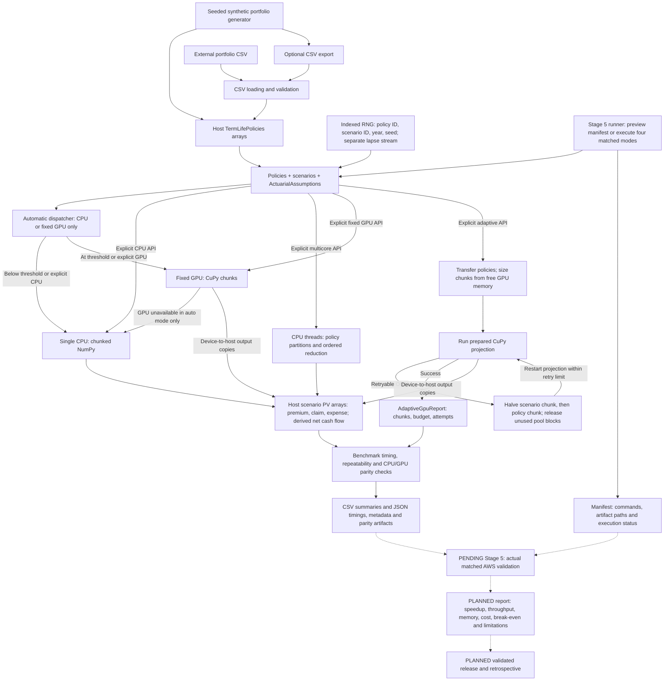

# Monte Carlo term-life architecture

This document describes the implemented Stage 3 term-life projection and Stage 4
adaptive GPU execution, plus implemented Stage 5 benchmark orchestration.
Actual Stage 5 AWS validation, final reporting and release remain pending.
The system is a Python library with local benchmark scripts. The earlier
claim-only engines remain separate. Portfolios and mortality assumptions are
illustrative, not a calibrated pricing or reserving basis.

## Execution flow

Solid arrows describe implemented data and execution paths. Dashed arrows lead
to planned Stage 5 work. The four execution modes share cash-flow semantics.

## Inputs, model and reproducibility

- [policy_generator.py](../src/monte_carlo_accelerator/policy_generator.py)
  provides `generate_term_life_portfolio`, using a seeded NumPy generator for
  synthetic ages, terms, sums assured and level annual premiums.
  [generate_stage3_portfolio.py](../benchmarks/generate_stage3_portfolio.py)
  optionally writes the canonical CSV schema.
- [portfolio_io.py](../src/monte_carlo_accelerator/portfolio_io.py) requires
  `policy_id,age_at_entry,sum_assured,annual_premium,term_years`. The loader
  checks required columns, nonempty input, numeric conversion, unique IDs,
  ages from 0 to 120, nonnegative monetary amounts and positive terms.
  These are loader checks; constructing `TermLifePolicies` directly does not
  invoke CSV validation.
- [models.py](../src/monte_carlo_accelerator/models.py) defines policy arrays,
  validated `ActuarialAssumptions` and `ActuarialProjectionResult`. Assumptions
  specify projection years, discounting, mortality scale, lapse rate, expenses,
  inflation, simulation seed and requested chunk sizes. Portfolio generation
  and simulation use separate seeds.
- Indexed SplitMix64-derived draws in
  [cpu_engine.py](../src/monte_carlo_accelerator/cpu_engine.py) and
  [gpu_engine.py](../src/monte_carlo_accelerator/gpu_engine.py) depend on policy
  ID, scenario ID, year and seed. Lapses use an XOR-offset seed. Draws are
  generated inside projection blocks, not stored as a full random-input cube.
  Chunk changes and CPU partitions preserve draws; floating-point reduction
  order can change the final few bits.

For each active policy year, premiums and maintenance expenses occur at the
beginning of the year; death claims occur at year end. Mortality uses the
illustrative age curve scaled by the assumptions. Lapses follow mortality and
affect the next year. Death, lapse or term expiry ends coverage. Claim and
expense inflation and discounting follow the configured assumptions.

All modes accumulate `float64` premium, claim and expense PV arrays, one value
per scenario after summing policies. Net cash-flow PV is premium minus claim
minus expense; its mean is available on the result. Working blocks scale with
policy chunk times scenario chunk, alongside policy storage and scenario
outputs, without a policy-by-scenario-by-year allocation. Multicore execution
has concurrent blocks and per-worker scenario results.

## Backend selection and memory boundaries

| Mode | Implementation and boundary |
| --- | --- |
| Single CPU | `project_term_life` in [actuarial_engine.py](../src/monte_carlo_accelerator/actuarial_engine.py); NumPy policy/scenario blocks with an annual loop. |
| Multicore CPU | `project_term_life_multicore` in [actuarial_multicore.py](../src/monte_carlo_accelerator/actuarial_multicore.py); `ThreadPoolExecutor` partitions policies, preserves IDs and sums partial scenario arrays in partition order. Worker count is explicit. |
| Fixed GPU | `project_term_life_gpu` in [actuarial_gpu_engine.py](../src/monte_carlo_accelerator/actuarial_gpu_engine.py); transfers policies to CuPy, runs requested chunks and copies three scenario arrays to NumPy. `prepare_gpu_term_life_policies` and `project_term_life_gpu_prepared` allow resident-policy reuse. |
| Adaptive GPU | `project_term_life_gpu_adaptive` and its `_prepared` variant in the same module; explicitly selected, returning `(result, AdaptiveGpuReport)`. |

[actuarial_dispatch.py](../src/monte_carlo_accelerator/actuarial_dispatch.py)
implements `project_term_life_auto`. Its configurable default threshold is
10,000,000 policy-scenario combinations. Below it, CPU runs without probing
CUDA. At or above it, automatic mode tries the **fixed GPU API** and falls back
to CPU only for `GPUUnavailableError`. Explicit `backend="gpu"` propagates
unavailability; other execution errors also propagate. The dispatcher does
**not** select multicore CPU or adaptive GPU. The threshold is an operating
policy, not a universal hardware crossover. CuPy remains optional.

Adaptive sizing reads free device memory after policy preparation, defaults to
70% of that memory and an estimate of 256 bytes per block cell, and accounts for
three `float64` scenario output arrays. It reduces scenario chunks first, then
policy chunks. On recognized allocation failure it halves chunks in that same
order, frees unused default-pool blocks and retries the entire prepared
projection. The default limit is eight retries after the initial attempt;
non-memory errors, exhausted retries or failure at a one-by-one chunk propagate.
Initial policy transfer occurs outside this retry loop, and output storage
cannot be reduced by shrinking chunks, so the budget is not a guarantee of fit.
The report records requested/effective chunks, free bytes, budget, estimated
bytes per cell and attempts; retries equal attempts minus one.

## Design tradeoffs

- Deterministic indexed RNG makes random inputs invariant to chunk sizes and
  worker partitions, allowing memory tuning without changing simulated events.
  It requires matching integer RNG operations across NumPy and CuPy; reductions
  still need tolerance-based comparisons.
- `float64` preserves the shared numerical parity target at a memory and
  throughput cost relative to lower precision. Parity is numerical, not a
  promise of bitwise-identical totals across reduction orders.
- Optional CuPy keeps CPU execution usable without CUDA. GPU preparation and
  host output copies are explicit boundaries whose costs matter for small jobs.
- Explicit adaptive selection exposes memory sizing and retry behavior to the
  caller. The automatic dispatcher remains a CPU/fixed-GPU threshold policy;
  applications must opt into adaptive execution and inspect its report.

## Benchmark and artifact boundaries

[benchmark_stage3_cpu.py](../benchmarks/benchmark_stage3_cpu.py) selects single
CPU or multicore via `--workers`. Generation or CSV loading is measured
separately. Projection timing includes thread setup and result reduction when
multicore is selected, but excludes portfolio setup, summaries, environment
collection and serialization. Cold means the first projection in the running
process, followed by unmeasured warmups and repeated warm measurements. Warm
premium, claim and expense arrays must repeat exactly within that configuration.
Every measured cold and warm result also receives component parity checks:
multicore uses an untimed single-worker reference; single-worker mode uses its
first warm result as a self-reference.
Host RSS is sampled every 5 ms, not measured as an exact allocation peak.

[benchmark_stage3_gpu.py](../benchmarks/benchmark_stage3_gpu.py) generates its
portfolio before timing and records CUDA startup and policy preparation
separately. Prepared compute includes the projection and synchronized output
copies to the host; it is not kernel-only timing. Warm end-to-end timing includes
policy transfer, projection and output copies in an already initialized process,
excluding portfolio generation and process startup. Repeated initialized-CUDA
calls populate `end_to_end_runs` and `end_to_end_summary`, including a median
and spread. These are not cold-start measurements; `end_to_end_run` retains
the first sample for compatibility.

With `--adaptive`, every cold, warm and end-to-end measured call reruns chunk
selection and the retry wrapper, including their overhead and any retries in
timing. Warmups also use the adaptive prepared API. Per-run adaptive reports
are authoritative because selected chunks can vary; top-level `adaptive_gpu`
and workload effective chunks describe only the cold prepared call.
GPU memory-pool snapshots are observations at recorded boundaries, not a
continuous peak device-memory measurement.

The GPU runner compares every measured cold, warm and end-to-end result with an untimed single-CPU
reference using the same portfolio, assumptions and seed. The reference uses
requested chunks, which may differ from adaptive effective chunks. Premium,
claim, expense and derived net PV must satisfy `rtol=1e-12, atol=1e-6`; failure
raises before successful benchmark artifacts are written. This correctness
reference is not a measured CPU speedup baseline.
Both Stage 3 runners emit schema-version 3 JSON with parity diagnostics for
every measured result. GPU top-level `parity` retains the first warm check for
compatibility; use per-run checks for full coverage. CPU parity includes premium,
claim, expense and net PV with the same tolerances, and failure also prevents
successful artifact writes.

Default artifacts under `results/` are:

| Runner | Outputs |
| --- | --- |
| CPU | `stage3_cpu_benchmarks.csv`, `stage3_cpu_benchmark_runs.csv`, `stage3_cpu_benchmark_latest.json`: summaries, cold/warm observations, setup, assumptions, worker count and environment. |
| GPU, fixed or adaptive | `stage3_gpu_benchmarks.csv`, `stage3_gpu_benchmark_latest.json`: timing boundaries, warm observations, component parity/errors, device/environment metadata, memory snapshots and optional adaptive report. |

CSV summaries append; default latest JSON files are overwritten. Use distinct
output paths to preserve comparison runs. Scenario arrays are returned in
memory; benchmark artifacts store summaries and parity diagnostics rather than
the full arrays. Throughput counts policy-scenario pairs per second; JSON also
records pairs times configured projection years.

## Stage 5 orchestration and pending validation

[benchmark_stage5.py](../benchmarks/benchmark_stage5.py) reuses the Stage 3
runners for single CPU, multicore CPU, fixed GPU and adaptive GPU with identical
workload flags and requested chunks. Default preview writes a schema-version 1
`manifest.json` containing commands and output paths without running benchmarks.
`--execute` runs them locally in sequence, records status and stops on failure,
marking remaining runs skipped. A fresh or empty output directory is required;
artifacts are separated by preset and mode. It does not provision AWS resources.

Following [STAGE5_PLAN.md](STAGE5_PLAN.md), remaining validation and release work is:

1. Collect raw evidence and run matched single-worker CPU, tuned multicore CPU,
   fixed GPU and adaptive GPU benchmarks on the final integrated revision.
   Match portfolios, assumptions, seeds and repetitions; record requested and
   effective chunks, workers, hardware/software and explicit timing boundaries.
2. Run the full tests and CPU/GPU numerical checks. Add or verify CPU CI and
   document the real CUDA environment and reproduction commands. CPU-backed
   GPU tests alone do not establish device performance or memory capacity.
3. Derive speedups from comparable repeated medians, throughput, memory use,
   cost per billion combinations and workload break-even. Date and qualify
   pricing assumptions and distinguish prepared compute from end-to-end cost.
4. Publish the methodology, raw artifacts, parity evidence, limitations and
   synthetic-data caveat, then tag a validated release and publish a retrospective.

This architecture document asserts no new benchmark results, performance gains
or completed deployment. Reported run completion without retained raw artifacts
does not establish a measured comparison.
